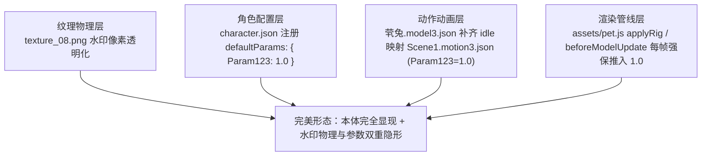

# Live2D 模型去水印与防盗版参数常驻锁定工程方案与规范

本文档记录 Live2D 模型去水印的通用经验、陷阱防范与永久锁定方案，作为后续所有 Live2D 模型去水印与参数防护的核心参考标准。

---

## 一、核心原理与常见陷阱

### 1. 水印与本体透明绑定的防盗版机制
- **参数控制机制**：很多创作者或二改模型会内置防盗版参数（例如兔兔模型的 `Param123`，对应快捷键 `Shift+P` 或表情 `sy.exp3.json`，西域舞女模型的 `Param191` 等）。
- **“一清全隐”陷阱**：模型本体网格（头发、脸庞、衣服、四肢）的不透明度可能与该参数强绑定：
  - 当参数处于默认值（如 `0.0`）时，模型本体透明度为 0（完全隐形），仅渲染水印卡片；
  - 若单纯用图像处理工具将水印贴图（如 `texture_08.png`）清空或透明化，模型由于参数仍为 `0.0`，整个人物会变为完全透明（彻底消失）。
- **“动作覆盖”陷阱**：即使在模型初始化时通过代码将参数赋值为 `1.0`，一旦触发了没有该参数曲线的动作（Motion）、待机循环（Idle）或表情切换，Live2D 动画引擎便会重新把该参数打回默认值 `0.0`，导致模型突然隐形或闪现水印。

---

## 二、兔兔（茕兔）永久锁定去水印方案（标准案例）

为了彻底解决“隐形”与“水印残留”，形成**「本体常驻完全显现 + 水印物理与参数双重永久隐藏」**，采用以下四层闭环强保方案：



### 1. 角色配置层：注册常驻参数
在角色配置文件 `characters/tutu/character.json` 中显式声明：
```json
{
  "defaultParams": {
    "Param123": 1.0
  }
}
```
使运行时系统能够识别该角色具有常驻强制参数。

### 2. 动作映射层：补齐待机循环动作
在 `characters/tutu/model/茕兔.model3.json` 的 `Motions` 组中补齐 `idle` / `Idle` 动作映射：
```json
"Motions": {
  "idle": [
    {
      "File": "Scene1.motion3.json"
    }
  ],
  "Idle": [
    {
      "File": "Scene1.motion3.json"
    }
  ]
}
```
其中 `Scene1.motion3.json` 包含 `Param123 = 1.0` 的恒定曲线，确保动画播放过程中参数始终恒定，防止参数被动作系统重置。

### 3. 渲染管线底层：每帧必经路径强保
在桌宠前端渲染脚本 `assets/pet.js` 的 `applyRig`（挂载在 `beforeModelUpdate` 阶段）中增加强保执行逻辑：
```javascript
// 强保逻辑：只要当前激活角色为兔兔或声明了 defaultParams，每帧强制推入目标值
if (activeRole === 'tutu' || (characterConfig && characterConfig.defaultParams)) {
  const params = (characterConfig && characterConfig.defaultParams) || { Param123: 1.0 };
  for (const [key, val] of Object.entries(params)) {
    coreModel.setParameterValueById(key, val);
  }
}
```
挂载在 `beforeModelUpdate`，每帧强制推入 `coreModel.setParameterValueById('Param123', 1.0)`，彻底免疫一切外部动作打断、物理引擎重置或姿态插值。

### 4. 纹理像素层：物理清空水印贴图
结合对 `texture_08.png` 水印像素区域的透明化处理（Alpha 置 0）：
- 物理上抹除水印图形像素；
- 参数上永久保持本体网格不透明度为 100%。

---

## 三、通用 Live2D 去水印标准流程指南

未来遇到任意 Live2D 模型的水印处理，均按此范式排查治理：

1. **查探防盗版参数与表情**：
   - 检查 `model3.json`、`expressions` 目录下的 `*.exp3.json` 或 `motions` 下的 `*.motion3.json`；
   - 搜索类似 `水印`、`sy`、`anti-theft`、`hide` 等关键字，定位目标参数 ID（如 `Param123`、`Param191` 等）。
2. **测试参数取值对本体的影响**：
   - 先通过快捷键、调试控制台手动修改该参数，确认参数为 0 与 1 时本体网格与水印网格的显隐状态，确认是否存在“参数控制本体不透明度”的反向绑定。
3. **落实多维永久锁定**：
   - 若存在反向绑定，严禁只单纯抹图；必须同步落实 **配置声明 + 待机 Motion 曲线保证 + 渲染引擎管线每帧强制推入**。
4. **纹理定向精准清空**：
   - 定位水印所在纹理（或多张纹理分片），仅对水印像素矩阵执行 Alpha 置 0，避免误伤服装、皮肤与共用网格贴图。
